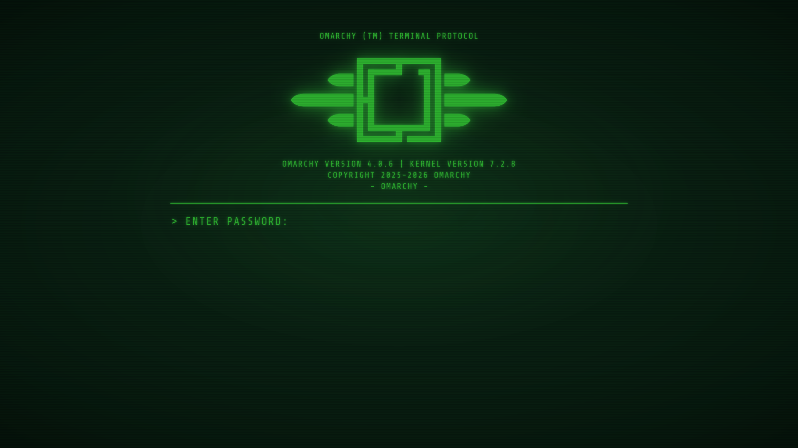
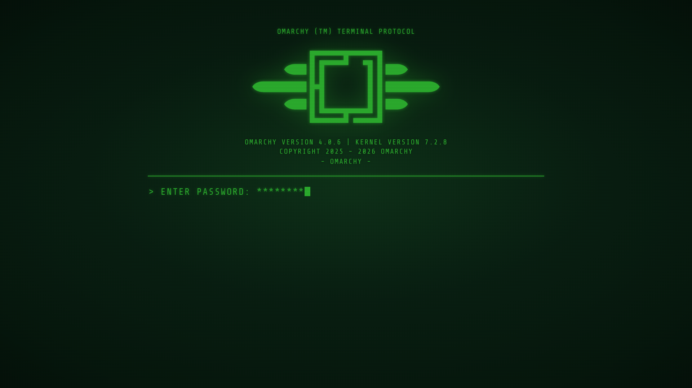

# Terminal Protocol Controller

An Omarchy shell plugin for the [Dark Terminal Protocol](https://github.com/Anerti/omarchy-dark-terminal-protocol-theme) theme. It adds a radiation icon to the right of the bar. Click it to get one switch for each part of the theme:

| Switch | What it does |
| ------ | ------------ |
| Menu bar | Vault-Tec wedge and Vault Boy status panels, or the built-in bar |
| Menu | Pip-Boy menu, or the Omarchy menu |
| Mouse cursor | VaultTec cursors (shipped here, in `cursors/`), or the cursor you had before |
| CRT effect | Scanlines and vignette screen shader (`bin/vault-tec-crt`), under any theme |
| Unlock screen | RobCo terminal lock screen, or Omarchy's |
| Login screen | Terminal boot screen, or the previous one. Opens a terminal for your sudo password, then rebuilds the initramfs |

When it loads, the plugin clones the theme into `~/.config/omarchy/themes/dark-terminal-protocol` if it is missing, and syncs the shell plugins from `plugins/` into `~/.config/omarchy/plugins`: missing ones are copied and stay off until you turn their switch on, installed ones are updated (restarting the shell if one in use changed). A copy edited in place, with a file newer than this checkout's, is left alone.

It also carries everything the Terminal Protocol themes share beyond their colours, so each part has one copy:

| Part | Command | Notes |
| ---- | ------- | ----- |
| Shell plugins | `bin/vault-tec-plugins [install\|sync\|uninstall] [id...]` | Pip-Boy menu, terminal lock screen, Vault-Tec workspaces wedge and the Vault Boy status panels, from `plugins/`. `install` restarts the shell, and a plugin is enabled only on its first install. `sync` copies the missing ones without enabling them, and updates the rest unless edited in place. |
| Cursors | `bin/vault-tec-cursor [install\|uninstall]` | Installs `~/.local/share/icons/VaultTec` and a hook that uses it while a Terminal Protocol theme (`dark-terminal-protocol`, `colored-terminal-protocol`) is active. The switch shows whether they are installed. |
| CRT effect | `bin/vault-tec-crt [on\|off\|toggle\|status]` | `assets/crt.frag` as a Hyprland screen shader. It also shows in screenshots and recordings. |
| Boot screen | `bin/vault-tec-plymouth [install\|uninstall\|test]` | Installs the `vault-tec` Plymouth theme (sudo) and rebuilds the initramfs. Its banner and footer show the Omarchy version, kernel and hostname, and are redrawn whenever the initramfs is rebuilt, including after Omarchy upgrades and kernel installs. Reinstalling only rewrites what changed, and `uninstall` restores the boot screen that was default before. `test` plays it from a text console (Ctrl+Alt+F3); its passphrase is `omarchy`. |

| Pip-Boy menu | Power panel |
| ------------ | ----------- |
|  |  |



| Boot: passphrase | Boot: initializing |
| ---------------- | ------------------ |
|  |  |

## Install

```bash
omarchy plugin add <this-repo-url> --enable
```

Or by hand:

```bash
rsync -a ./ ~/.config/omarchy/plugins/anerti.terminal-protocol-controller/
omarchy-shell shell rescanPlugins
omarchy plugin enable anerti.terminal-protocol-controller --section right
```

The plugin was first published as `anerti.vault-tec`. If you installed that, remove it so you do not get two icons: `omarchy plugin remove anerti.vault-tec`.

## How it works

`bin/terminal-protocol-controller` does the work, and `Panel.qml` only displays its state:

```bash
bin/terminal-protocol-controller status    # JSON: installed, busy, bar, menu, cursor, crt, unlock, login
bin/terminal-protocol-controller install   # clone the theme if missing, sync the plugins
bin/terminal-protocol-controller set <bar|menu|cursor|crt|unlock|login> <on|off>
```

The bar, menu and unlock switches run `bin/vault-tec-plugins` (install and enable, or disable and bring back the built-in), then restart the shell. Switching the bar or the menu also lays the bar out again. Switches are queued one at a time. Logs go to `~/.cache/terminal-protocol-controller/control.log`.

`tests/dry-run` checks each switch against a stub theme and a stub home without touching the desktop.
